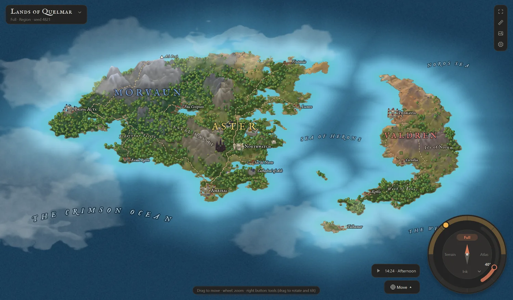
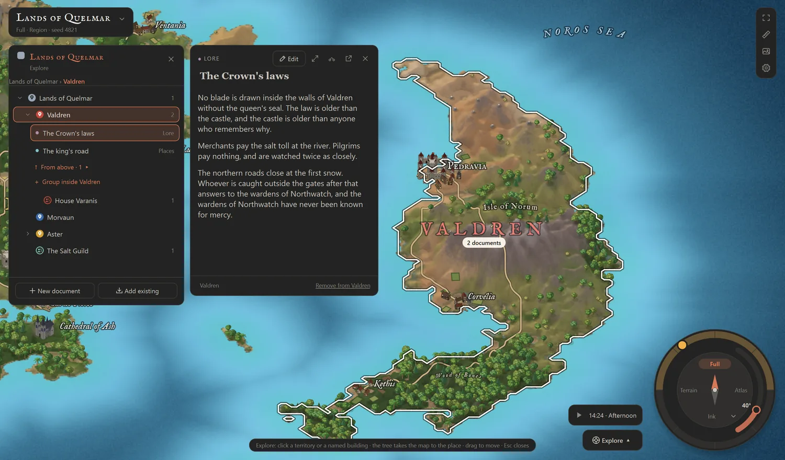

Qenna Writer (formerly Mira Writing, briefly Qiyva Writer) is a complete
C++/Qt rebuild of the original Mira Writing (JSX) — same project, new name
and identity.

This repository holds the **source code** of the application. For
downloads of the releases, go to:
https://github.com/Pedrovskigg/Qenna-Writer-releases

---

Qenna Writer is a text editor and multi-document manager built entirely for
the craft of creative writing — drawers for characters, settings and
objects, multi-manuscript projects, a visual Board for plotting, a Timeline,
a world-building tool (the Builder), writing goals and stats, and more, all
wrapped in a fully themeable editor with Focus Mode.

Qenna Writer is free — no subscriptions, no paywalled features. Made by one
writer, for other writers.

## New in 1.5: the Map



Qenna Writer now draws maps. Generate a continent from a seed or paint one
by hand; the terrain is real relief (a mountain is height, not a picture of
a mountain), and altitude, latitude and humidity decide the climate and the
biome of every patch of ground.

- **Build** on it: castles in a dozen styles, landmarks, legends, ships and
  sea monsters, and brushes that paint whole cities and forests.
- **Explore** it: every territory is a group in your project. Click it and
  its documents open beside the map, readable and editable. Name a castle
  and it becomes a place of its own.
- **See it** in the afternoon or at night, with the windows lit, or in the
  Ink, Parchment, Nautical chart, Topographic, Watercolor and War plan views.
- A ruler with travel time, several maps per project, and PNG export at 1×,
  2× or 3× for the front of the book.



## Tech stack

- C++17, Qt 6.8 (Core, Gui, Widgets, Svg, Multimedia, Network, TextToSpeech)
- CMake + Ninja, MinGW-w64 (GCC) on Windows
- [Hunspell](https://github.com/hunspell/hunspell) for spell-checking
- zlib (from the MinGW toolchain) for reading theme packages
- LibreOffice Hunspell dictionaries and MyThes thesauri, plus OpenWordnet-PT,
  for spell-checking and synonyms
- Natural Earth, GeoNames and flag-icons for the offline world map

## Building from source (Windows)

1. Install [Qt 6.8+](https://www.qt.io/download-open-source) (MinGW 64-bit
   kit) and its bundled CMake/Ninja/MinGW under Qt Maintenance Tool, or your
   own CMake 3.16+ / Ninja / MinGW-w64 toolchain.
2. Clone Hunspell v1.7.2 into `third_party/hunspell` (not vendored in this
   repo — see [cmake/Hunspell.cmake](cmake/Hunspell.cmake)):
   ```powershell
   git clone --depth 1 --branch v1.7.2 https://github.com/hunspell/hunspell.git third_party/hunspell
   ```
3. Configure and build:
   ```powershell
   $env:PATH = "C:\Qt\Tools\mingw1310_64\bin;C:\Qt\Tools\Ninja;C:\Qt\Tools\CMake_64\bin;" + $env:PATH
   & "C:\Qt\6.8.3\mingw_64\bin\qt-cmake.bat" -G Ninja -S . -B build
   cmake --build build
   ```
4. Run it:
   ```powershell
   $env:PATH = "C:\Qt\6.8.3\mingw_64\bin;" + $env:PATH
   & .\build\qenna-writer.exe
   ```

The "Immersive Sound" ambient tracks (`src/assets/ambience-sounds/`) aren't
included in this repo — the app builds and runs fine without them, just
without that one feature's audio files.

## Translations

Qenna Writer is currently available in PT-BR, EN-US, ES, IT, and FR, via Qt
Linguist (`translations/*.ts`). Language switches at runtime through the
Main Menu.

## License

Qenna Writer is open for reading, modification, and redistribution.
However, any and all redistribution of the code must remain free of
charge and open. See the full license here: [LICENSE](LICENSE).

(GPL-3.0, supplemented by a Commons Clause condition and a mandatory
author-attribution term.)

Third-party components (Qt, Hunspell, FFmpeg, bundled fonts, etc.)
keep their own licenses — see
[THIRD-PARTY-NOTICES.md](THIRD-PARTY-NOTICES.md).

## Related projects

- [Cover Creator](https://github.com/Pedrovskigg/qenna-cover-creator) —
  the old standalone cover tool, discontinued in 1.5 (covers are now made
  inside Qenna, with the Quick cover)
- [Mira's Maestro](https://github.com/Pedrovskigg/Maestro) — free musical
  theory plugin

## Contact

To report bugs, suggest new features or just scream about your plot at
3:00 AM: `qennawriter@gmail.com`
I can take a few hours or days to answer, but I will! I promise!
Or you can reach me on GitHub as well, on Qenna's repository.

— P.H. Lobato
